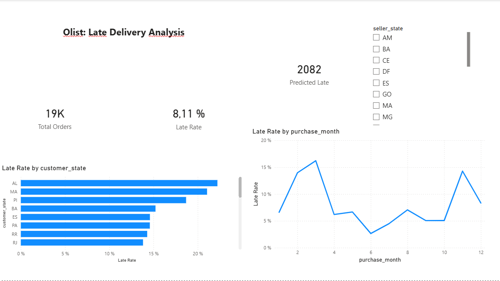

# Olist: Late Delivery Prediction

End-to-end analytics project: SQL, Python, machine learning and Power BI to predict late deliveries on Olist e-commerce data.

## Business problem
Late deliveries hurt customer satisfaction. Which orders are likely to arrive late, and why?

## Tools
- **PostgreSQL**: data storage, joins and feature table
- **Python** (pandas, scikit-learn): analysis and Random Forest model
- **Power BI**: dashboard on delivery performance and predictions

## Workflow
1. Imported the Olist dataset (Kaggle) into PostgreSQL (8 tables).
2. Wrote SQL queries to explore the data and built a feature table, `orders_features`.
3. Loaded it in Python, prepared the data and trained a Random Forest classifier.
4. Saved the predictions back to PostgreSQL (`orders_predictions`).
5. Built a Power BI dashboard on top of the predictions.

## Key results
- 96,470 delivered orders, of which **8.11% were late**.
- Random Forest: **ROC-AUC = 0.744**.
- With a lowered decision threshold (0.2), the model catches **37%** of late orders (recall), with 28% precision. The default threshold caught only 7%.
- Most important features: estimated delivery days, price, freight cost, weight and purchase month.

## Dashboard insights
- Northeastern states (AL, MA, PI) have late rates above 18%.
- Late deliveries peak in February-March and in November.

## Files
- `01_exploration.ipynb`: Python analysis and model
- `olist_dashboard.pbix`: Power BI dashboard
- `dashboard.png`: dashboard screenshot

## Possible improvements
- Add more features (seller history, distance between customer and seller).
- Try other models (XGBoost, logistic regression) and compare.

## Data
[Brazilian E-Commerce Public Dataset by Olist](https://www.kaggle.com/datasets/olistbr/brazilian-ecommerce) (Kaggle)
